  

<h2 align="left">Oi! Eu sou a Esthefany Chichineli ✨</h2>

### ✨ Minha Trajetória & Objetivos

Meu interesse por tecnologia começou ainda no ensino médio, quando concluí o **curso técnico em TI** e dei meus primeiros passos na área. Hoje, estou cursando **Análise e Desenvolvimento de Sistemas (ADS)** na **UniCesumar** e me dedicando diariamente a construir uma base prática sólida com foco em **DevOps, Cloud e Infraestrutura**.

Atualmente, estou aprofundando meus fundamentos em **Lógica de Programação, Git/GitHub, Python e Linux** por meio de exercícios e projetos práticos.

* 🎯 **Objetivo atual:** Conquistar meu **1º estágio em TI / DevOps** (remoto ou híbrido) para aprender na prática, contribuir com a equipe e construir minha carreira no Brasil.
* 🚀 **Visão de futuro:** Após concluir a graduação e ganhar experiência sólida, me especializar como **Engenheira DevOps** com foco em **atuação internacional**.

 

---

### 🛠️ Tecnologias e Ferramentas

  
  
  
  
  
  
  
  
  
  
  
  
  
  
  

---

### 📈 Estatísticas & Contribuições

  
  

 

<picture>
  <source media="(prefers-color-scheme: dark)" srcset="https://raw.githubusercontent.com/esthefany15/esthefany15/pacman-output/bomberman-contribution-graph-dark.svg?game=bomberman">
  <source media="(prefers-color-scheme: light)" srcset="https://raw.githubusercontent.com/esthefany15/esthefany15/pacman-output/bomberman-contribution-graph.svg?game=bomberman">
  
</picture>

---

### 💌 Vamos conversar?
- 📍 **Localização:** Curitiba, PR - Brasil *(Disponível para remoto ou híbrido)*
- 📫 **E-mail:** eathefanyoliveira2204@gmail.com

  
  

